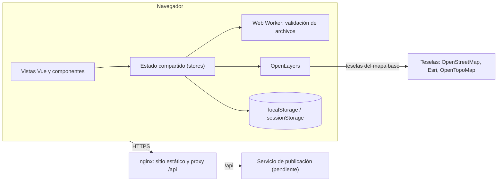

# DeltaMap-CEDESU

Geoportal para reunir, revisar, consultar y publicar con control la información geográfica de los estudios del CEDESU, Universidad Autónoma de Campeche.

[](https://github.com/afedo-al/Geoportal_UACAM/actions/workflows/ci.yml)


-informational)


> Este repositorio es una implementación de desarrollo. No es el repositorio oficial de la UACAM ni del CEDESU.

## Resumen

El CEDESU genera mapas, coordenadas, fotografías y hojas de cálculo que hoy están repartidos entre computadoras, carpetas y formatos. DeltaMap-CEDESU ofrece un solo lugar para consultarlos en un mapa, documentarlos con una ficha, revisarlos antes de publicarlos y registrar puntos de campo.

Lo que lo distingue:

- **Revisión antes de publicar.** Una capa pasa por estados explícitos (en revisión, aprobada, publicada, archivada) y solo una persona administradora la publica.
- **Validación por contenido.** Cada archivo se identifica por lo que contiene, no por su extensión, y se revisa en un Web Worker sin congelar la pantalla.
- **Procedencia visible.** Cada dato de la ficha indica si viene del archivo, es una sugerencia o un valor por defecto.
- **Sin instalación para quien consulta.** Funciona en el navegador, en escritorio y en celular.

Estado actual: la **interfaz está completa y funciona con datos de ejemplo**. El **servicio de publicación (API) no existe todavía**; sin él no hay usuarios reales, persistencia ni publicación definitiva. Ver [Limitaciones y hoja de ruta](#limitaciones-y-hoja-de-ruta).

## Índice

- [Características](#características)
- [Arquitectura](#arquitectura)
- [Inicio rápido](#inicio-rápido)
- [Configuración](#configuración)
- [Despliegue](#despliegue)
- [Seguridad y privacidad](#seguridad-y-privacidad)
- [Referencia de la API](#referencia-de-la-api)
- [Modelo de datos](#modelo-de-datos)
- [Pruebas](#pruebas)
- [Estructura del proyecto](#estructura-del-proyecto)
- [Limitaciones y hoja de ruta](#limitaciones-y-hoja-de-ruta)
- [Autor y licencia](#autor-y-licencia)

## Características

**Inicio** (`#/bienvenida`)
- Mapa de Campeche con recorrido por las cabeceras municipales.
- Accesos según el perfil: el público ve mapa y catálogo; con sesión se suman Carga, Captura GPS y Revisión.
- Lista de estudios del catálogo con acceso a su ficha.

**Mapa** (`#/`)
- Capas que se encienden y apagan; mapa base de calles, satélite o topográfico.
- Consulta de atributos de cada entidad y herramientas de medición de distancias y áreas.
- Búsqueda de lugares de Campeche, capas y coordenadas.
- Coordenadas en WGS 84 y UTM 15N/16N; simbología editable por capa.

**Catálogo** (`#/catalogo`)
- Búsqueda por título, tema o fuente y filtros por tema y año.
- Ficha por estudio: resumen, responsable, licencia, cobertura, calidad y linaje, atributos y versiones.
- Copiar cita y exportar la ficha en XML.

**Carga de datos** (`#/carga`, con sesión)
- Lectura y validación en el navegador de GeoJSON, Shapefile (también en ZIP), KML/KMZ, GPX, CSV y Excel.
- GeoPackage y GeoTIFF se validan en el navegador; su interpretación queda para el servidor.
- Vista previa en mapa, ficha de estudio por capa y aviso si ya existe una capa publicada con el mismo nombre (actualizar o crear capa nueva).

**Captura GPS** (`#/gps`, con sesión)
- Registro de puntos con ubicación del dispositivo, clic en el mapa o coordenadas escritas (grados o UTM).
- Altitud, predio, autor, tipo, descripción y fotografía (hasta 2 MB).
- Importación de Excel con columnas `Name`, `X`, `Y`, `Autor`; X e Y se detectan como grados WGS 84 o metros UTM.
- Los Excel importados se ven como tabla editable, se eliminan por fila o completos, y generan una capa en Carga.
- Exportación a CSV.

**Revisión** (`#/revision`, con sesión)
- Estados: en revisión, aprobada, requiere corrección, publicada y archivada, con nota obligatoria al devolver o archivar.
- Al publicar una nueva versión se archiva la anterior de la misma capa; solo las archivadas se pueden eliminar.

## Arquitectura



Decisiones clave:

| Decisión | Motivo |
|---|---|
| Sitio estático (Vue 3 + Vite) | Se publica en cualquier servidor web y no requiere servidor de aplicaciones para consultar. |
| Rutas con `#/` (hash) | El servidor nunca necesita devolver `index.html` para otra ruta. |
| Validación en un Web Worker | Un Shapefile grande no congela la interfaz. El mismo código lo puede reutilizar el servidor. |
| Estado en módulos reactivos (sin librería de estado) | La aplicación es pequeña; evita una dependencia más. |
| API configurable al compilar (`VITE_API_BASE`) | Sin API la interfaz lo indica en lugar de simular una publicación. |
| Revisión en navegador solo como primera barrera | La validación definitiva debe repetirla el servidor. |

## Inicio rápido

Requiere Node.js 20.19 o superior y acceso a internet para instalar dependencias (SheetJS se descarga de `cdn.sheetjs.com`).

```bash
git clone https://github.com/afedo-al/Geoportal_UACAM.git
```

```bash
cd Geoportal_UACAM/web
```

```bash
npm ci
```

```bash
npm run dev
```

La aplicación queda en `http://127.0.0.1:5174`.

Comandos disponibles, desde `web/`:

| Comando | Qué hace |
|---|---|
| `npm run dev` | Servidor de desarrollo en el puerto 5174. |
| `npm test` | Pruebas unitarias con `node --test`. |
| `npm run build` | Compila a `web/dist` (con copias `.gz` y `.br`). |
| `npm run preview` | Sirve `web/dist` en `http://127.0.0.1:5175` con cabeceras de seguridad. |
| `npm run start` | Compila y sirve en un solo paso. |
| `npm run verify` | Pruebas y build; es lo que ejecuta la integración continua. |

Cuenta de demostración **solo para uso local**: en `npm run dev` existe una cuenta que se valida en el navegador y permite recorrer las pantallas de administración. Sus datos aparecen en el diálogo «Iniciar sesión». No protege nada y no está en el build de producción.

No abras `web/dist/index.html` con doble clic: los navegadores no cargan módulos desde `file://`.

## Configuración

No hay archivos `.env` en el repositorio. Las variables se pasan al comando.

| Variable | Cuándo se usa | Descripción | Valor por defecto |
|---|---|---|---|
| `VITE_API_BASE` | Al compilar (`npm run build`) | Dirección del servicio de publicación, por ejemplo `/api`. Debe ser del mismo origen o HTTPS. | Sin definir: acceso de administración deshabilitado. |
| `GEOPORTAL_API` | `npm run dev` y `npm run preview` | Dirección a la que Vite redirige `/api` en desarrollo. | Sin definir: sin proxy. |
| `VITE_DEMO_LOCAL` | Al compilar | Con valor `1` y sin `VITE_API_BASE`, incluye la cuenta de demostración en el build. Solo para pruebas internas. | Sin definir: la cuenta solo existe en `npm run dev`. |

Ejemplos:

```bash
GEOPORTAL_API=http://127.0.0.1:8000 npm run dev
```

```bash
VITE_API_BASE=/api npm run build
```

Constantes en código (no son variables de entorno): cierre por inactividad de 30 minutos en `web/src/config.js`; límites de carga en `web/src/lib/filecheck.js`.

Los secretos del servicio de publicación no pertenecen a este repositorio: deben definirse como variables de entorno del servidor y nunca en el código de la interfaz.

## Despliegue

El despliegue no está hecho; este es el procedimiento previsto.

1. Compilar con la dirección de la API:

```bash
cd web
```

```bash
VITE_API_BASE=/api npm run build
```

2. Servir `web/dist` con nginx e incluir [deploy/nginx-seguridad.conf](deploy/nginx-seguridad.conf) dentro del bloque `server` con TLS. Ese archivo define las cabeceras de seguridad, la compresión estática y el proxy de `/api` a `127.0.0.1:8000`.

Advertencias:

- **Sin API no hay persistencia.** Los puntos de campo y las ediciones del catálogo se guardan solo en el navegador de quien los captura y se pierden al borrar los datos del sitio.
- **TLS obligatorio.** La ubicación del dispositivo y las cabeceras HSTS lo requieren.
- Publicar únicamente `web/dist`; no `docs/`, respaldos ni archivos temporales (el archivo de nginx ya lo bloquea).
- `client_max_body_size` está en 410 MB para cargas de hasta 400 MB por lote.
- La política de seguridad de contenido (CSP) del build y la de nginx deben mantenerse iguales.

## Seguridad y privacidad

Medidas implementadas en la interfaz (detalle en [docs/seguridad.md](docs/seguridad.md)):

| Área | Medida |
|---|---|
| Archivos | Identificación por contenido (firmas), no por extensión; se rechazan ejecutables, scripts, HTML/SVG con código, PDF y comprimidos renombrados. |
| ZIP | Rechazo de rutas con `..`, cifrado, ejecutables, comprimidos anidados, más de 300 entradas y descompresión desproporcionada. |
| XML | KML y GPX con `DOCTYPE`, entidades u hojas de estilo externas se rechazan. |
| Shapefile | Validación de cabeceras, tamaños, coherencia entre `.shp`, `.shx` y `.dbf`. |
| CSV y Excel | Celdas que parecen fórmulas se marcan y se neutralizan al exportar; se rechazan macros y objetos incrustados. |
| Integridad | Huella SHA-256 por archivo y bloqueo de duplicados en el lote. |
| Límites | 60 capas y 400 MB por lote; 60 MB por archivo leído en el navegador; 20 MB por Excel de puntos; 2 000 filas por importación; 5 000 puntos guardados en el navegador. |
| Sitio | CSP restrictiva (sin scripts en línea ni de terceros), `frame-ancestors 'none'`, `X-Content-Type-Options`, `Referrer-Policy`; en nginx se suman HSTS y `Permissions-Policy`. |
| Presentación | Vue escapa el texto; las ventanas del mapa se construyen con `textContent`. |
| Datos locales | Lo leído de `localStorage` se valida: campos conocidos, texto recortado, ids válidos y únicos, URL de foto restringidas. |
| API | Solo mismo origen o HTTPS; cabecera `X-Requested-With` y token CSRF en peticiones que modifican datos; tiempo máximo por petición. |
| Fotografías | Solo PNG, JPEG o WebP comprobados por contenido y de hasta 2 MB. |
| Credenciales | El build de producción no contiene contraseñas; la cuenta de demostración queda fuera salvo `VITE_DEMO_LOCAL=1`. |

Privacidad:

- La ubicación del dispositivo se consulta solo al pulsar «Usar mi ubicación» y no se envía a ningún servidor.
- No hay analítica ni scripts de terceros.
- Los mapas base descargan teselas de OpenStreetMap, Esri y OpenTopoMap; esos proveedores reciben la dirección IP y la zona consultada.

La validación en el navegador **no sustituye** la del servidor.

## Referencia de la API

El servicio no existe en este repositorio. La tabla es el contrato que la interfaz ya espera (ver [docs/api-contrato.md](docs/api-contrato.md)); todas las rutas cuelgan de `VITE_API_BASE`.

| Método | Ruta | Descripción |
|---|---|---|
| GET | `/sesion` | Estado de la sesión actual; deja la cookie CSRF. |
| POST | `/sesion` | Inicia sesión (`usuario`, `contrasena`, `codigo` opcional). |
| DELETE | `/sesion` | Cierra la sesión. |
| GET | `/demo` | Datos de la cuenta de demostración, si el servidor la ofrece. |
| GET | `/capas` | Capas publicadas con su ficha. |
| GET | `/capas/<id>.geojson` | Geometría de una capa publicada. |
| PUT | `/capas/<id>/estilo` | Guarda la simbología de una capa (`{ "simbologia": {...} }`). |
| GET | `/cargas?estado=` | Cargas, filtradas por estado, con totales. |
| POST | `/cargas/` | Envía una capa (multipart: archivos, `capa`, `clave`, `sha256`, `estudio`, `crs`, `mapeo`, `modo`). |
| GET | `/cargas/<id>` | Detalle de una carga. |
| GET | `/cargas/<id>/geojson` | Vista previa de la carga. |
| POST | `/cargas/<id>/estado` | Cambia el estado (`estado`, `nota`). |
| DELETE | `/cargas/<id>` | Elimina una carga archivada. |
| GET | `/puntos` | Puntos de campo. |
| POST | `/puntos` | Crea un punto. |
| PUT | `/puntos/<id>` | Edita un punto. |
| DELETE | `/puntos/<id>` | Elimina un punto. |
| POST | `/puntos/lote` | Crea varios puntos (importación de Excel). |

Transiciones de estado que la interfaz permite:

| Desde | Hacia |
|---|---|
| en revisión | aprobada, requiere corrección, archivada |
| aprobada | publicada, requiere corrección, archivada |
| requiere corrección | en revisión, archivada |
| publicada | archivada |
| archivada | en revisión |

## Modelo de datos

No hay base de datos en este repositorio. Estas son las entidades que maneja la interfaz.

**Estudio** (ficha de una capa; `web/src/lib/study-fields.js`)

| Campo | Descripción | Obligatorio |
|---|---|---|
| `sTitle` | Título | Sí |
| `sTheme` | Tema (lista cerrada: Hidrología, Suelos, Riesgos, Vegetación, Topografía, Clima, División territorial, Fauna, Levantamiento de campo) | Sí |
| `sDate` | Fecha del estudio | Sí |
| `sResp` | Responsable | Sí |
| `sLic` | Licencia (CC BY 4.0, CC BY-NC 4.0, CC BY-NC 2.5 MX, Uso restringido) | Sí |
| `sAccess` | Acceso (Pública o Interna) | Sí |
| `sSource` | Fuente original | No |
| `sDesc` | Descripción | No |
| `sLineage` | Procedencia y metodología | No |
| `sKeywords` | Palabras clave | No |

**Carga** (revisión)

| Campo | Descripción |
|---|---|
| `id`, `layerKey`, `version` | Identificador, clave estable de la capa y número de versión. |
| `titulo`, `capa`, `formato`, `crs`, `entidades` | Datos de la capa. |
| `estado`, `estadoTexto`, `transiciones`, `nota` | Estado actual y movimientos permitidos. |
| `autor`, `revisor`, `creada`, `actualizada`, `publicada` | Responsables y fechas. |
| `reemplazaId`, `reemplazaTitulo` | Versión que esta reemplaza. |
| `archivos` | Nombre, tamaño y huella SHA-256 de cada archivo. |
| `estudio`, `revision`, `historial` | Ficha, resultados de la revisión y bitácora de movimientos. |

**Punto de campo**

| Campo | Descripción |
|---|---|
| `id`, `name`, `type`, `description` | Identificación y descripción. |
| `lat`, `lon`, `altitude` | Coordenadas WGS 84 y altitud en metros (-500 a 9 000, opcional). |
| `property`, `author` | Predio y autor. |
| `date`, `time`, `photo` | Fecha, hora y fotografía. |

**Almacenamiento en el navegador**

| Clave | Contenido |
|---|---|
| `cedesuGPSPoints`, `cedesuGPSVersion` | Puntos de campo y versión del formato. |
| `cedesuGPSImports` | Índice de los Excel importados. |
| `cedesuLayerStyles` | Simbología editada. |
| `cedesuDatasetEdits`, `cedesuHiddenDatasets` | Fichas editadas y conjuntos ocultos de las capas de ejemplo. |
| `cedesuWelcomeVisitedV3` | Marca de que ya se vio el Inicio. |

## Pruebas

Desde `web/`:

```bash
npm test
```

Son 41 pruebas unitarias con `node --test`, sin dependencias adicionales. Cubren:

| Archivo | Qué cubre |
|---|---|
| `coords.test.js` | Validación de latitud, longitud y altitud. |
| `geo.test.js` | Conversión WGS 84 y UTM, lectura de coordenadas, escalas y áreas. |
| `excel-points.test.js` | Detección de grados o UTM en las filas de un Excel. |
| `format.test.js` | Formatos, firmas de archivo, URL de fotos y neutralización de fórmulas. |
| `studyinfo.test.js` | Tema sugerido a partir del nombre y los campos de la capa. |
| `review-demo.test.js` | Flujo de revisión, versiones, archivado y eliminación. |
| `gps-layer.test.js` | Conversión de puntos a capa. |
| `point-ids.test.js` | Identificadores de punto válidos y únicos. |

No hay pruebas de las vistas ni de integración con navegador. La integración continua ejecuta `npm run verify` en cada push y pull request a `main` ([.github/workflows/ci.yml](.github/workflows/ci.yml)).

## Estructura del proyecto

```text
.
├── .github/workflows/ci.yml        # Pruebas y build en cada cambio a main
├── deploy/
│   └── nginx-seguridad.conf        # Cabeceras de seguridad, compresión y proxy /api
├── docs/
│   ├── api-contrato.md             # Lo que la interfaz espera del servicio
│   ├── propuesta_geoportal.md      # Propuesta y objetivos del proyecto
│   ├── plan-implementacion-y-diseno.md
│   ├── pruebas-revision-qgis.md    # Pruebas de revisión con QGIS
│   ├── seguridad.md                # Controles de seguridad de la interfaz
│   └── presentacion/               # Presentación y guiones que generan sus capturas
└── web/
    ├── index.html
    ├── vite.config.js              # CSP, compresión, preload y proxy de desarrollo
    ├── public/data/                # Capas de ejemplo en GeoJSON
    ├── src/
    │   ├── main.js, App.vue, router.js, config.js
    │   ├── views/                  # Inicio, Mapa, Catálogo, Carga, Captura GPS, Revisión
    │   ├── components/             # Barra superior, buscador, paneles, diálogos, ficha
    │   ├── stores/                 # Estado: ui, sesión, mapa, capas, carga, estudios, GPS
    │   ├── lib/
    │   │   ├── api.js              # Cliente de la API
    │   │   ├── filecheck.js        # Validación de archivos por contenido
    │   │   ├── ingest-core.js      # Lectura y validación de formatos geográficos
    │   │   ├── ingest.worker.js    # Ejecuta la lectura fuera del hilo principal
    │   │   ├── studyinfo.js        # Metadatos que declaran los archivos
    │   │   ├── review-demo.js      # Flujo de revisión local de desarrollo
    │   │   ├── excel-points.js     # Coordenadas de un Excel de puntos
    │   │   ├── gps-layer.js        # Puntos a capa
    │   │   ├── layer-key.js        # Clave estable de una capa
    │   │   └── geo.js, coords.js, format.js, ...
    │   └── styles/main.css         # Sistema de diseño
    └── tests/                      # Pruebas unitarias
```

## Limitaciones y hoja de ruta

Limitaciones actuales:

- **No existe el servicio de publicación.** Sin él no hay usuarios reales, persistencia compartida, segunda validación de archivos, antivirus ni bitácora permanente.
- **La revisión y la publicación solo funcionan en modo local de desarrollo** y viven únicamente en la pestaña.
- **Una capa publicada con acceso «Interna» se muestra igual en modo local.** Filtrar por acceso corresponde al servidor.
- **Los puntos de campo y las ediciones del catálogo se guardan solo en el navegador.**
- **Capas de ejemplo.** Las de `web/public/data/` son de ejemplo; la de climas cita a CONABIO y las de municipios y entidades tienen su procedencia por documentar.
- GeoPackage y GeoTIFF solo se validan en el navegador; no se previsualizan.
- No hay pruebas automatizadas de las vistas ni de integración.
- El repositorio no versiona la carpeta `backend/`.

Hoja de ruta, en orden:

1. Construir el servicio de publicación según [docs/api-contrato.md](docs/api-contrato.md): sesiones y roles, cargas en cuarentena, revisión, capas publicadas y puntos.
2. Repetir en el servidor las validaciones de archivos y de la ficha.
3. Persistir versiones y bitácora; conservar la bitácora al eliminar una capa.
4. Filtrar capas por acceso en el servidor.
5. Excluir el flujo de revisión local del build de producción.
6. Definir la licencia del proyecto y documentar la procedencia de las capas de ejemplo.

Fuera de alcance en esta etapa: análisis especializados sobre los mapas, registro de recorridos y conexión con sistemas de otras instituciones.

## Autor y licencia

Desarrollado por el equipo Digital Path, Facultad de Ingeniería, Universidad Autónoma de Campeche (UACAM), en colaboración con el Centro de Estudios para el Desarrollo Sustentable y Aprovechamiento de la Vida Silvestre (CEDESU), que aporta los requerimientos y la información geográfica.

Licencia: **sin definir**. El repositorio no incluye un archivo de licencia, por lo que los permisos de copia, modificación y distribución dependen de una decisión de la UACAM y del CEDESU. Los datos, logotipos y documentos institucionales pueden tener condiciones distintas a las del código y no deben redistribuirse sin autorización.
